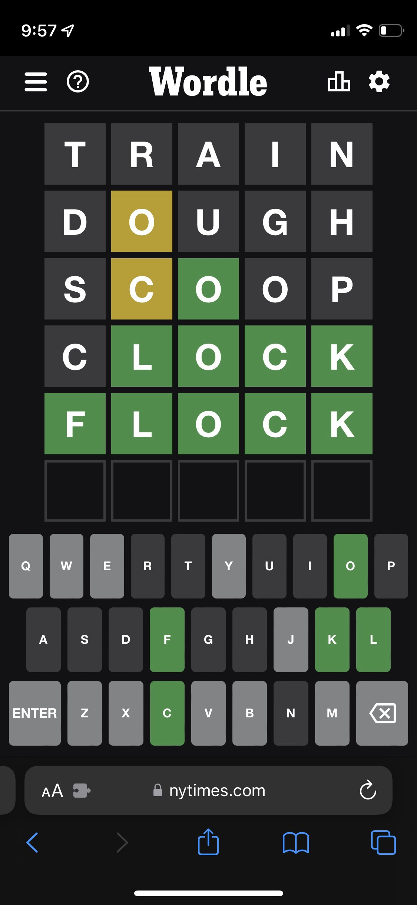

# QND Computer Science Day 13
Mr. Schmidt

###### Backup plan: Arrays and Wordle

--- 

# Today

- Arrays
- Wordle (Stages 1-3)
  - Use the **Text** playground

---

# What's Next?

Wordle
- Very fun game
- Very simple



<!-- -->
<!-- Explain the rules of wordle -->
<!-- Multi-day process -->

---

# Putting a value in a String

```swift
let flavor = "Chocolate"

console.write("The flavor is " + flavor)
console.write("The flavor is \(flavor)") // Same thing!
```

- `\( )` puts a value inside a string
- Wordle's code uses this

---

# What does this output?
```swift
let ice_cream_flavors = ["Chocolate", "Vanilla", "Cookies and Cream", "Strawberry"]

for flavor in ice_cream_flavors {
    console.write("The flavor is \(flavor)")
}
```

<!-- -->
<!-- Should iterate through the Array and console.write each option -->
<!-- Discuss Array syntax (brackets, commas) -->
<!-- Discuss empty Array -->
---

# What does this output?

```swift
let ice_cream_flavors = ["Vanilla", "Chocolate", "Cookies and Cream", "Strawberry"]

let my_favorite = ice_cream_flavors[2]
console.write("My favorite flavor is \(my_favorite)")

```

<!-- -->
<!-- Get a show of hands for each option -->
--- 

# Why do Arrays start at zero?

- It's a single block of memory
  - The first element is at the first address
- It's what lots of other languages do

---
# What happens when we change 2 to 4?

```swift
let ice_cream_flavors = ["Vanilla", "Chocolate", "Cookies and Cream", "Strawberry"]
                          // 0          1             2                   3 

let my_favorite = ice_cream_flavors[2]
console.write("My favorite flavor is \(my_favorite)")


```

<!-- -->
<!-- Show indices past the end of the Array lead to an error -->

--- 

# Array Contains

- How to check if a Array contains an item?

```swift
if ice_cream_flavors.contains("Chocolate") {
    console.write("Yum!")
}
```

---


# Wordle

- Multiple stages, each one builds on the last


---

# Stage 1: Grade a Guess

- Turn a string into an Array
- Get a guess from the user
- Check each letter of the secret word
  - `for i in 0..<5` counts 0, 1, 2, 3, 4

---

# Capital Letters

- `Hello` is not `hello`
- iPad capitalizing your guess? Add `.lowercased()`

```swift
let guess = Array(console.read("Guess a word:").lowercased())
```

---

# Stage 2: Looping and Validation

- Put the guess part in a loop
- Check if the guess is the right length
  - Use `continue`
- Check if the guess is correct!

---

# While Loops

- `while true` will repeat forever

```swift
while true {
  console.write("This will repeat forever!")
}
```

---

# `break`

- Use `break` to exit a loop!

```swift
while true {
  let command = console.read("Enter a command")
  if command == "q" {
    break
  }
  // do something else
}

```

---


# Stage 3: Guess Count Limit
- Track the number of guesses
- If guesses >= 6, tell the user they lost
- Random word from a word bank!
  - `wordBank.randomElement()!`
