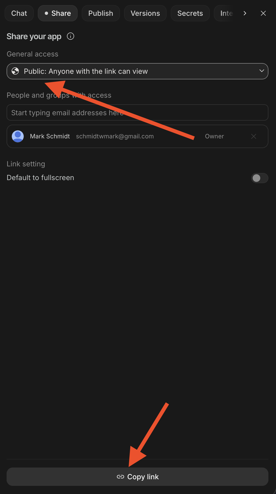

# QND Computer Science Day 16
Mr. Schmidt

--- 

# Today

- Last Day of Coding

---

# Expectations

- Let's make good use of time today
- Build your project in AI studio

---

# Tomorrow

- We'll do a show and tell of everyone's projects
- Present *either* your turtle project or your AI Studio project
- Informal -- I will show your project and maybe ask some questions
- Make sure your project is something you're proud to share!

---

# Final Project Requirements

- Make something cool with AI Studio
  - It cannot just be the Swift Playground game
- Keep it appropriate
- Be creative and have fun!
- The focus is *building something* not *playing something*
  - You'll have to use your app to iterate, but you should be adding features and improving it, not just playing a game
- On Friday, I'll show either your AI Studio app *or* your turtle project

---

# Final Project Ideas

- Take your Adventure game and make a visual novel version
- Make a personal dashboard to track homework assignments, todos, events, etc.
- Build a quiz app about a topic you love 
- Make a journaling app
- Make a website for a school club or sports team

- Try the "I'm feeling lucky" button and see what you get!

---

# Project Submission

- Use the Share button
- Make sure to make it publicly viewable!

